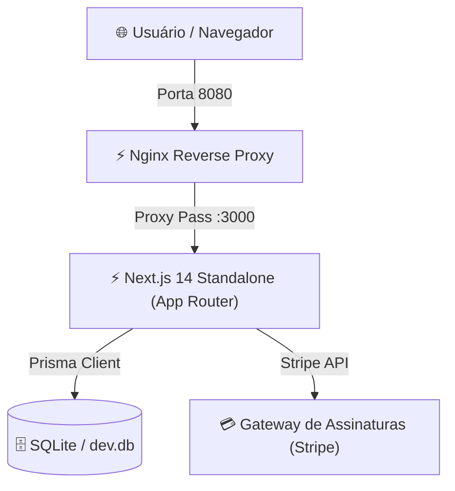

<div align="center">

# ⚡ Micro-SaaS — Next.js 14, Shadcn UI & NextAuth v5

<p align="center">
  
</p>

[](https://nextjs.org/)
[](https://www.typescriptlang.org/)
[](https://tailwindcss.com/)
[](https://www.prisma.io/)
[](https://authjs.dev/)
[](https://www.docker.com/)
[](#)

<cite>Plataforma completa de Micro-SaaS moderna com autenticação passwordless e credenciais de teste em 1 clique, integração de planos com quotas, gestão de tarefas e infraestrutura Docker otimizada.</cite>

</div>

---

## 📌 Visão Geral

O **Micro-SaaS Next.js 14** é uma solução completa para lançamento de produtos de software como serviço (SaaS). A aplicação foi construída utilizando os mais modernos padrões do ecossistema React/Next.js:

- **Autenticação Híbrida (NextAuth v5 / Auth.js):** Suporte a Magic Links via Nodemailer e provedor de credenciais com **botões de login rápido em 1 clique** para testes imediatos.
- **Controle de Assinaturas & Quotas:** Integração com Stripe e controle de limite de tarefas por plano (*Free* com 5 tarefas e *Pro* com 100 tarefas).
- **Interface Moderna (Linear-like):** Componentes estilizados com Shadcn UI, Radix Primitives, Tailwind CSS e alternância de temas claro/escuro.
- **Stack Docker Otimizada:** Build standalone do Next.js com Nginx reverse proxy na porta 8080 e cache de assets estáticos.

---

## 🏛️ Arquitetura da Solução



---

## ✨ Funcionalidades

- **Dashboard do Assinante:** Visualização de tarefas, barra de progresso de uso da quota do plano e atalhos rápidos.
- **Gestão de Tarefas (Todos):** Criação, listagem e marcação de tarefas concluídas vinculadas ao ID do usuário autenticado.
- **Portal de Faturamento (Billing):** Tela de upgrade/downgrade de planos conectada ao Stripe Checkout e Customer Portal.
- **Perfis Demo em 1 Clique:** Três contas pré-configuradas sem necessidade de confirmação de e-mail.
- **API de Health Check:** Endpoint `/api/health` para diagnóstico contínuo da aplicação e do Prisma ORM.

---

## 👥 Perfis de Acesso & Demonstração (1 Clique)

Na tela de login (`/auth`), você pode conectar instantaneamente com qualquer um dos perfis abaixo:

| Perfil | E-mail | Senha | Plano Ativo | Quota de Tarefas |
|---|---|---|---|---|
| **Administrador** | `admin@microsaas.com` | `Password@123` | **Plano Pro** | 100 tarefas |
| **Gerente** | `gerente@microsaas.com` | `Password@123` | **Plano Pro** | 100 tarefas |
| **Operador** | `operador@microsaas.com` | `Password@123` | **Plano Free** | 5 tarefas |

---

## 🛠️ Tecnologias Utilizadas

- **Framework:** Next.js 14.2.7 (App Router & Server Actions)
- **Linguagem:** TypeScript 5.0
- **Estilização:** Tailwind CSS & Shadcn UI (Radix UI)
- **ORM & Banco:** Prisma ORM com SQLite
- **Autenticação:** NextAuth.js v5 (Auth.js) com `@auth/prisma-adapter`
- **Pagamentos:** Stripe SDK
- **Servidor Web:** Nginx 1.25 Alpine
- **Conteinerização:** Docker & Docker Compose v2

---

## 🚀 Como Executar

### 1. Clonar o Repositório
```bash
git clone https://github.com/omartins-zs/micro-saas-nextjs.git
cd micro-saas-nextjs
```

### 2. Execução com Docker (Recomendado)
```bash
# Configurar variáveis de ambiente
cp .env.example .env

# Subir a stack completa
docker compose up -d --build
```
Acesse [http://localhost:8080](http://localhost:8080).

### 3. Execução Local (Host)
Consulte as instruções detalhadas em [`docs/COMO_EXECUTAR_LOCAL.md`](file:///C:/Projetos/micro-saas-nextjs/docs/COMO_EXECUTAR_LOCAL.md).

---

## 📚 Documentação Complementar

- [Acessos, Credenciais e Testes](file:///C:/Projetos/micro-saas-nextjs/docs/ACESSOS_TESTES.md)
- [Como Executar - Visão Geral](file:///C:/Projetos/micro-saas-nextjs/docs/COMO_EXECUTAR.md)
- [Como Executar Localmente](file:///C:/Projetos/micro-saas-nextjs/docs/COMO_EXECUTAR_LOCAL.md)
- [Como Executar com Docker Compose](file:///C:/Projetos/micro-saas-nextjs/docs/COMO_EXECUTAR_DOCKER.md)

---

<div align="center">

Feito com ❤️ por **[Gabriel Martins](https://github.com/omartins-zs)** 🚀

</div>
